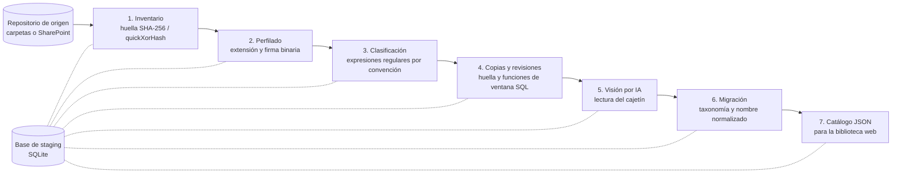
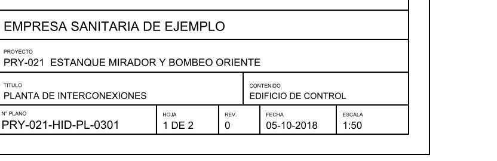
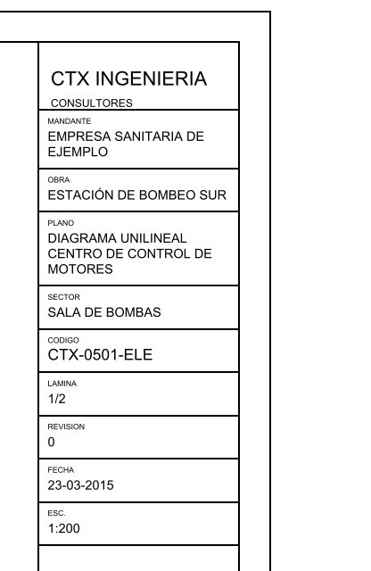
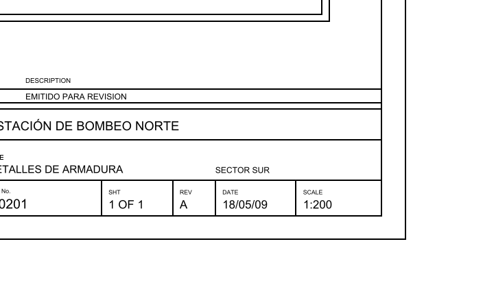

# Pipeline documental con visión por IA

Proceso en Python para ordenar un repositorio heredado de planos y documentos de ingeniería: inventaría cada archivo, reconoce qué es, detecta copias, lee los cajetines de los planos con visión por IA y migra todo a una biblioteca con una taxonomía documental.

Es la versión de portafolio, con datos sintéticos, de un sistema que diseñé e implementé para catalogar cientos de miles de planos alojados en SharePoint.

## El problema

Un repositorio que creció durante años sin reglas comunes:

- Cada época y cada contratista nombró los archivos a su manera: `PRY-021-ELE-DU-0045-H02-RevB`, `PRY014_EL_0503_1_A`, `CTX-0501-ELE-R1-L2`, `E-0505-B` y también `Plano1.dwg` o `copia de planta final OK.dwg`.
- Cientos de extensiones distintas, incluidos archivos sin extensión y nombres con fechas escritas con puntos (`Informe 12.03.2015`).
- Copias del mismo archivo con otros nombres, en carpetas de respaldo.
- Varias revisiones de cada plano, sin una marca de cuál está vigente.
- Ediciones hechas sobre un plano sin emitir una revisión nueva.

## Cómo funciona



Las etapas no se pasan datos en memoria: cada una lee y escribe una base de staging. Por eso cada etapa se puede ejecutar sola, repetir sin duplicar y retomar después de una interrupción.

| Etapa | Qué resuelve |
|---|---|
| Inventario | Una fila por archivo, con su huella de contenido. En SharePoint usa la consulta `delta` de Microsoft Graph, que recorre la biblioteca completa sin entrar carpeta por carpeta, y la huella viene en el listado: no se descarga nada. |
| Perfilado | Asigna categoría (CAD, PDF, ofimática, temporal, sistema). Cuando la extensión no es confiable lee los primeros bytes del archivo y reconoce el tipo por su firma binaria. |
| Clasificación | Un patrón de expresión regular por convención de nombres. Obtiene proyecto, disciplina, tipo, número, hoja, revisión y título. Lo que el nombre no dice queda marcado para la lectura por IA. |
| Copias y revisiones | Dos archivos con la misma huella son el mismo. De cada grupo se conserva uno, eligiendo el que no está en una carpeta de respaldo. Luego marca la revisión vigente de cada plano (A < B < 0 < 1). |
| Visión por IA | Dibuja el plano DXF, recorta la zona del cajetín y la envía a la API de Anthropic. La respuesta llega como JSON validado contra un esquema que solo admite los códigos de la taxonomía. Si el recorte no basta, envía la lámina completa. |
| Migración | Ubica cada archivo en `Planos/<disciplina>/<tipo>/<proyecto>/` con un nombre normalizado y sus metadatos. Reintenta ante límites del servicio respetando `Retry-After` y aparta para revisión humana los casos en que dos contenidos distintos reclaman el mismo plano y revisión. |
| Catálogo | Una entrada por plano u hoja, con todas sus revisiones y formatos. Lo consume la [biblioteca web](../02-biblioteca-web). |

## Lectura de cajetines con IA

Los cajetines vienen de distintas épocas y oficinas, así que no sirve una plantilla fija de coordenadas. El generador de datos de prueba produce tres formatos reales en DXF:

| Horizontal en español | Franja vertical | Antiguo, rótulos en inglés |
|---|---|---|
|  |  |  |

Decisiones de diseño:

- **Salidas estructuradas.** El modelo responde con un esquema JSON fijo. Disciplina, tipo y proyecto solo pueden tomar valores de la taxonomía, y todo campo puede venir vacío: un dato inventado es peor que uno faltante.
- **Dos pasadas para cuidar el costo.** Primero se envía solo el recorte del cajetín y, únicamente si ahí no se lee, la lámina completa.
- **Instrucciones en caché.** El texto del sistema, con la taxonomía, es igual en todas las llamadas y se marca para la caché de prompts.
- **El nombre manda, la IA completa.** Si el nombre del archivo y el cajetín se contradicen en un dato de identidad (número, revisión), el archivo queda para revisión humana con la contradicción anotada.
- **Nunca se paga dos veces.** Cada lectura se guarda con su respuesta y sus tokens. Las copias no se envían.
- **Respaldo ante rechazos.** Las llamadas activan el respaldo automático del servidor (`fallbacks`), que repite la solicitud en otro modelo si un clasificador de seguridad la declina.

## Resultados con datos sintéticos

Con el repositorio de demostración (2.164 archivos), comparando contra la verdad conocida del generador:

| Comprobación | Resultado |
|---|---|
| Copias exactas detectadas | 490 de 490, sin falsos positivos |
| Temporales y archivos de sistema detectados | 234 de 234 |
| Archivos con extensión engañosa reconocidos por su firma | 19 de 19 |
| Campos de plano obtenidos del nombre | 100 % de precisión; el resto queda para la lectura por IA |

A escala, con cientos de miles de archivos sintéticos y cientos de extensiones distintas, en un computador personal:

| Etapa | Tiempo |
|---|---|
| Inventario | 48 s |
| Perfilado | 4 s |
| Clasificación | 12 s |
| Copias y revisiones (22,5 % de copias) | 21 s |
| Planificación de la migración | 7 s |
| Catálogo | 5 s |

En el caso real los tiempos los domina la red: el listado y el movimiento de archivos en SharePoint, y la lectura por IA. Por eso esas etapas son reanudables y respetan los límites del servicio.

## Cómo ejecutarlo

```bash
pip install -r ../requirements.txt

python -m pipeline demo                 # crea un repositorio sintético en _demo/
python -m pipeline ejecutar --vistas 36 # todas las etapas y el catálogo de la biblioteca
python -m pipeline evaluar              # exactitud contra la verdad conocida
python -m pipeline reporte              # estado del repositorio en Markdown

# Lectura de cajetines con IA (requiere ANTHROPIC_API_KEY o `ant auth login`)
python -m pipeline vision --max 20
python -m pipeline evaluar

# Medición a escala, sin crear archivos
python -m pipeline escala --archivos 300000
```

Para trabajar sobre SharePoint: `--origen sharepoint://<id de la biblioteca>` y las variables `GRAPH_TENANT_ID`, `GRAPH_CLIENT_ID` y `GRAPH_CLIENT_SECRET` de un registro de aplicación con permiso sobre el sitio.

## Pruebas

```bash
pytest 01-pipeline-documental-ia/tests      # desde la raíz del repositorio
```

Incluyen el pipeline completo sobre un repositorio sintético, la migración ante límites y fallas del servicio, el conector de SharePoint contra respuestas simuladas de Graph y la lectura por IA con el SDK real de Anthropic contra una API simulada. La calidad de lectura del modelo no se prueba en CI: se mide con `python -m pipeline evaluar` después de una corrida real.

## Tecnologías

Python, SQLite y SQL (funciones de ventana), expresiones regulares, Microsoft Graph, API de Anthropic con visión y salidas estructuradas, ezdxf, Pillow, MSAL.
