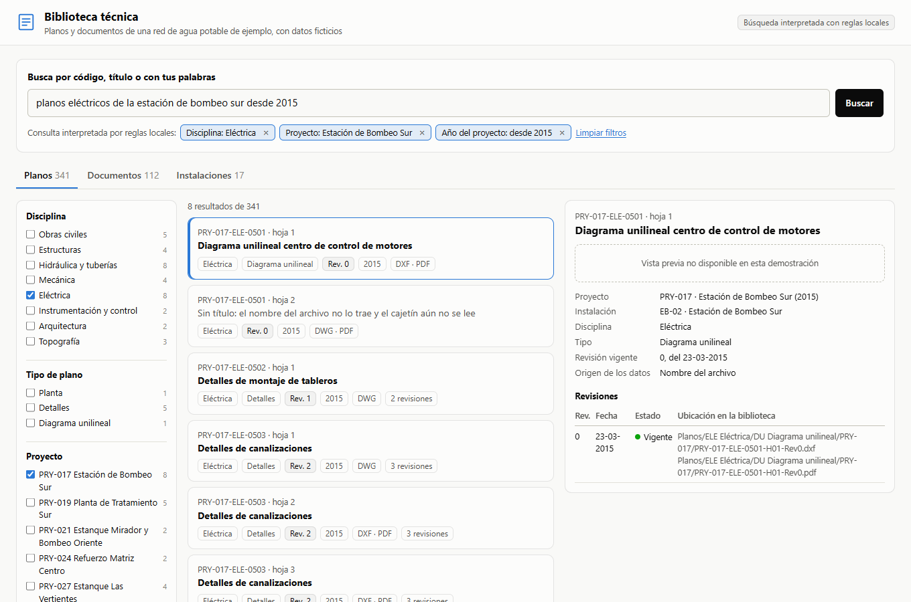
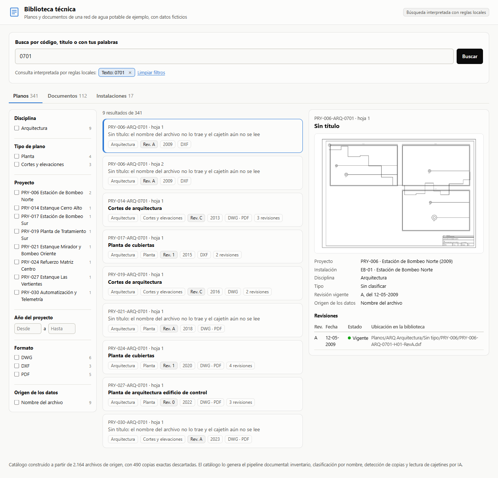
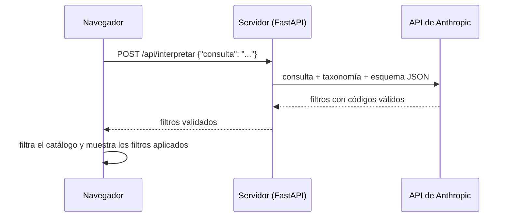

# Biblioteca técnica con búsqueda asistida por IA

**[Ver la demo en vivo](https://mrissoc.github.io/datos-con-proposito/02-biblioteca-web/)**

Aplicación web para encontrar planos y documentos de ingeniería. Se alimenta del catálogo que produce el [pipeline documental](../01-pipeline-documental-ia) y está organizada con una taxonomía de estilo bibliotecario: disciplina, tipo de plano o documento, proyecto, instalación y año.



## Qué permite

- **Buscar con tus palabras.** "Planos eléctricos de la estación de bombeo sur desde 2015" se convierte en filtros: disciplina Eléctrica, instalación EB-02, año desde 2015. Los filtros aplicados se muestran y cada uno se puede quitar.
- **Filtrar por la taxonomía**, con el conteo de resultados de cada opción.
- **Ver la ficha de cada plano**: vista previa, revisión vigente, historial de revisiones con su ubicación en la biblioteca, copias encontradas en el origen y de dónde salieron sus datos (nombre del archivo o cajetín leído por IA).
- **Navegar por instalación** de la red.



## Búsqueda en lenguaje natural



- La credencial de la API queda en el servidor: el navegador nunca la ve.
- El modelo responde con **salidas estructuradas**: un esquema JSON cuyos campos solo admiten códigos que existen en el catálogo. El servidor vuelve a validar cada código antes de responder.
- Si el servidor no tiene credenciales, o la llamada falla, la página interpreta la consulta con un **intérprete local** de reglas y sinónimos ([interprete.js](interprete.js)). Así la demostración funciona también publicada como página estática.

## Cómo ejecutarlo

```bash
# Con búsqueda por IA (requiere ANTHROPIC_API_KEY o `ant auth login`)
python -m biblioteca                    # http://127.0.0.1:8010/

# Solo la página, con el intérprete local
python -m http.server 8000              # http://127.0.0.1:8000/
```

El catálogo de ejemplo está en `datos/`. Para regenerarlo: `python -m pipeline demo` y `python -m pipeline ejecutar --vistas 36` en la carpeta del pipeline.

## Pruebas

`pytest 02-biblioteca-web/tests` desde la raíz. Usan el SDK real de Anthropic contra una API simulada para comprobar lo que se envía (modelo, esquema, instrucciones) y cómo se tratan los errores, los rechazos y las respuestas incompletas.

## Tecnologías

HTML, CSS y JavaScript sin frameworks, FastAPI, API de Anthropic con salidas estructuradas.
