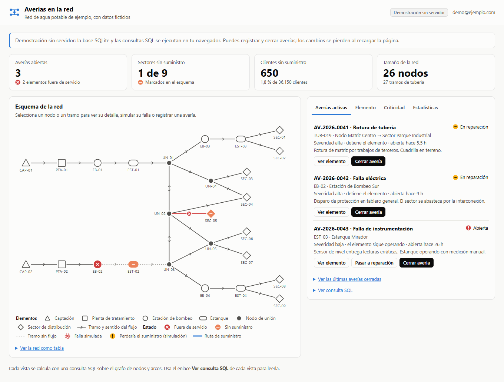
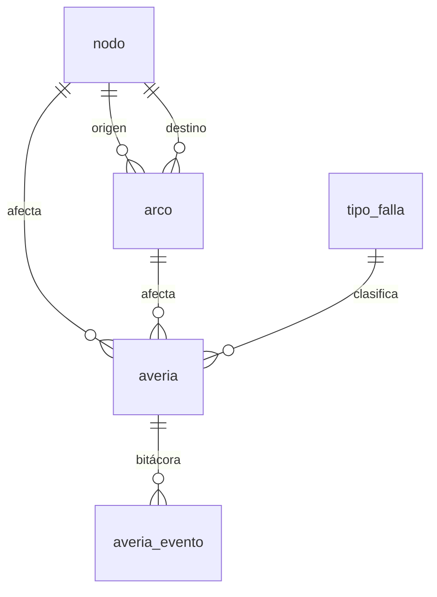
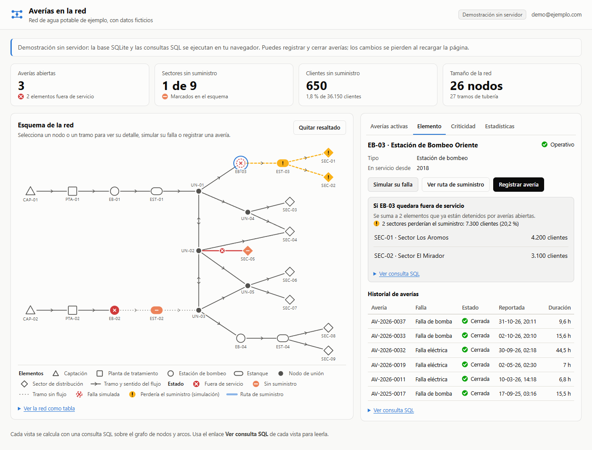
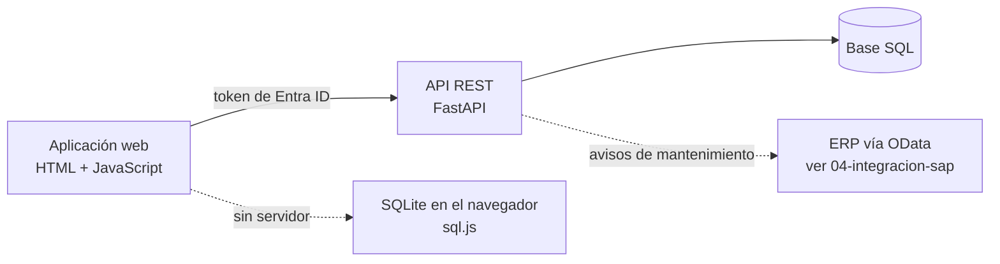

# Averías sobre una red de activos modelada como grafo en SQL

Aplicación para registrar averías en una red de agua potable y responder, con SQL, la pregunta que importa en operación: **¿a quién deja sin servicio esta falla?**



## El modelo: nodos y arcos

La red se guarda como un grafo dirigido en dos tablas: `nodo` (captaciones, plantas, bombeos, estanques, uniones y sectores de consumo) y `arco` (las tuberías, algunas bidireccionales). Las averías apuntan a un nodo o a un arco, nunca a ambos, y una restricción `CHECK` lo garantiza.



El estado de la red no se guarda: se calcula. Un nodo tiene suministro si se puede llegar a él desde alguna captación recorriendo solo elementos en servicio, y eso es una **consulta recursiva** (`WITH RECURSIVE`). Al cerrar una avería, el suministro se restablece solo, sin columnas de estado que mantener.

## Consultas de análisis

Todas en [sql/consultas](sql/consultas), una por archivo. La aplicación muestra cada una con su enlace "Ver consulta SQL".

| Consulta | Qué responde |
|---|---|
| [impacto_simulado.sql](sql/consultas/impacto_simulado.sql) | ¿Qué sectores perderían el suministro si además fallara este elemento? Simula sin escribir nada. |
| [criticidad.sql](sql/consultas/criticidad.sql) | Análisis N-1: clientes afectados por la falla individual de cada uno de los 44 elementos, en una sola consulta recursiva que arrastra el escenario junto con cada nodo alcanzado. |
| [ruta_suministro.sql](sql/consultas/ruta_suministro.sql) | Ruta más corta por la que hoy llega el agua a un nodo, evitando ciclos y elementos detenidos. |
| [estadisticas_elementos.sql](sql/consultas/estadisticas_elementos.sql) | Elementos con más averías en 12 meses y su tiempo promedio de reparación, con `DENSE_RANK`. |



Las reglas de negocio también viven en la base: triggers que impiden modificar una avería cerrada, que exigen que el tipo de falla corresponda al elemento (una "rotura" es de tubería, no de bomba) y que escriben la bitácora de cada cambio de estado.

## Arquitectura y login corporativo



- **Login corporativo con Microsoft Entra ID.** Con `AUTH_MODO=entra`, la web inicia sesión con la cuenta de la organización (MSAL, flujo con PKCE) y la API valida cada token: firma contra las claves del tenant, emisor, audiencia y vencimiento. Registrar averías exige el rol de aplicación `Averias.Operador`; sin él, el acceso es de lectura. Las pruebas cubren tokens vencidos, de otra organización, para otra aplicación y firmados con otra clave.
- **Demostración sin servidor.** Publicada como página estática, la aplicación abre la base SQLite dentro del navegador y ejecuta los mismos archivos `.sql` que usa la API.

Detalle del despliegue en [docs/despliegue.md](../docs/despliegue.md).

## Cómo ejecutarlo

```bash
python -m averias                  # http://127.0.0.1:8000/  (documentación de la API en /docs)
python -m averias.construir_bd     # regenera la base de demostración
```

Para el login corporativo: `AUTH_MODO=entra`, `ENTRA_TENANT_ID`, `ENTRA_AUDIENCIA`, `ENTRA_CLIENTE_WEB` y `ENTRA_ALCANCE`.

## Pruebas

`pytest 03-averias-grafos-sql/tests` desde la raíz: 28 pruebas de la lógica de grafos (el análisis N-1 se contrasta con un recorrido independiente escrito en Python), de las restricciones de la base, de la API y del login corporativo.

## Tecnologías

SQL (consultas recursivas, funciones de ventana, triggers, vistas), SQLite, FastAPI, Microsoft Entra ID, JavaScript, SVG, sql.js.
