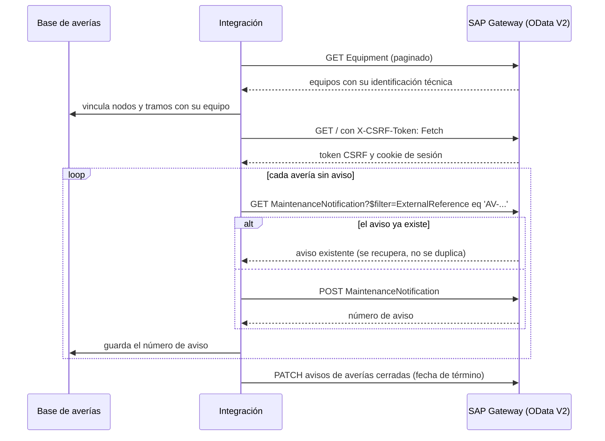

# Integración con SAP por OData

Conecta la [aplicación de averías](../03-averias-grafos-sql) con el mantenimiento en SAP: vincula cada elemento de la red con su equipo en SAP, crea un aviso de mantenimiento por cada avería y le informa a SAP cuando la avería se cierra.

Incluye un **simulador de SAP Gateway** para desarrollar y probar sin acceso a un SAP real. Los nombres de entidades y campos son ilustrativos: en un proyecto real se toman del servicio que publique la organización.

## Flujo



## Lo que resuelve el cliente

- **Token CSRF.** SAP exige pedir un token antes de escribir y enviarlo con la cookie de sesión. Si la sesión vence (403 con `X-CSRF-Token: Required`), el cliente pide uno nuevo y repite la operación.
- **Paginación del servidor.** Sigue los enlaces `__next` y avanza con `$top` y `$skip`.
- **Reintentos seguros.** Las lecturas se reintentan ante errores transitorios. Una creación solo se repite cuando SAP indica que no la procesó (429): repetir a ciegas un POST que sí llegó crearía un aviso duplicado.
- **Idempotencia.** Antes de crear un aviso se busca por la referencia externa: si una ejecución anterior lo creó y se cortó antes de guardar el número, se recupera.
- **Errores legibles.** Se extrae el mensaje del cuerpo de error de OData (por ejemplo, "El texto breve admite 40 caracteres como máximo").
- **Conciliación.** Informa los equipos de SAP sin elemento en la red y los elementos de la red sin equipo en SAP.

## Cómo ejecutarlo

```bash
python -m integracion_sap simulador                 # SAP simulado en el puerto 8090 (usuario demo / clave demo)
python -m integracion_sap sincronizar --bd ../03-averias-grafos-sql/datos/averias.db
```

## Pruebas

`pytest 04-integracion-sap/tests` desde la raíz: 20 pruebas contra el simulador corriendo en un puerto real, incluido el vencimiento del token, la paginación, los errores transitorios y la recuperación de un aviso ya creado.

## Tecnologías

Python, OData V2, requests, FastAPI (simulador), SQLite.
