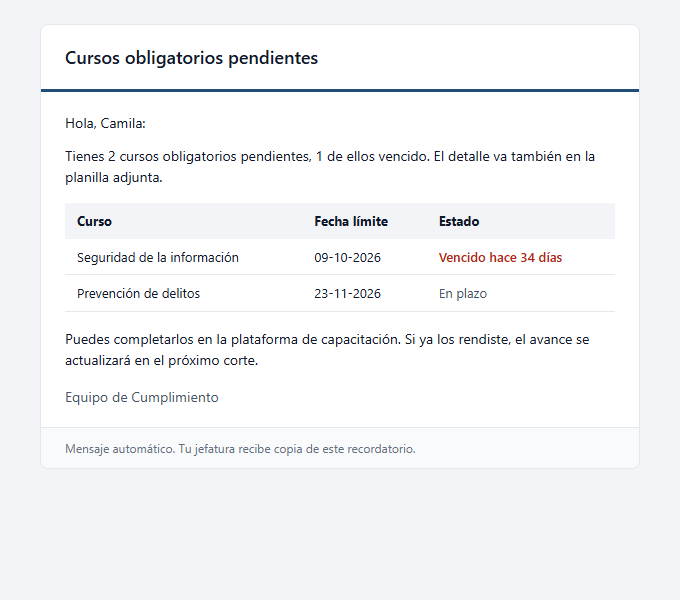
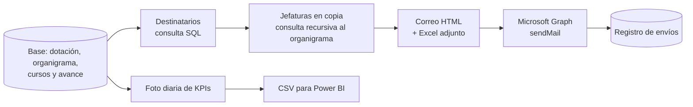

# Recordatorios masivos de capacitación con Microsoft Graph

Envía a cada persona un correo con sus cursos obligatorios pendientes, con copia a su jefatura según el organigrama y una planilla Excel adjunta. Además guarda una foto diaria de los indicadores para ver en Power BI cómo evoluciona el avance.

Versión de portafolio, con datos ficticios, de un sistema que implementé para un programa de cumplimiento en varios países.



## Cómo funciona



- **Destinatarios dinámicos.** No hay listas fijas: cada ejecución escribe solo a quienes hoy tienen cursos pendientes.
- **Copia según organigrama.** Una consulta recursiva sube por la cadena de jefaturas; se elige cuántos niveles reciben copia.
- **Correo en HTML** con estilos en línea, que es lo que respetan los clientes de correo, y todo dato escapado.
- **Envío desatendido por Microsoft Graph**, con una aplicación registrada en Entra ID y un buzón compartido. Respeta `Retry-After` cuando Graph limita los envíos.
- **Sin duplicados.** Cada envío queda registrado por campaña: si el proceso se interrumpe, al repetirlo nadie recibe dos veces el mismo recordatorio y los envíos fallidos se reintentan.
- **Varios países** con textos y formatos de fecha propios.
- **Evolución de los KPIs.** La plataforma de cursos solo muestra el estado de hoy; guardar una foto diaria permite ver el avance en el tiempo. La variación diaria se calcula con una función de ventana (`LAG`).

## Cómo ejecutarlo

```bash
python -m correos datos                  # base de ejemplo y 30 días de historial de KPIs
python -m correos enviar --pais Chile    # simulación: deja cada correo y su adjunto en salida/
python -m correos foto                   # foto de KPIs de hoy y exportación a powerbi/

# Envío real (requiere un registro de aplicación con permiso Mail.Send)
python -m correos enviar --pais Chile --real
```

Variables para el envío real: `GRAPH_TENANT_ID`, `GRAPH_CLIENT_ID`, `GRAPH_CLIENT_SECRET` y `CORREO_REMITENTE`.

## Pruebas

`pytest 05-correos-masivos-graph/tests` desde la raíz: selección de destinatarios, copias por organigrama, contenido escapado, planilla adjunta, la solicitud exacta a Graph, reintentos, envíos sin duplicados e historial de KPIs.

## Tecnologías

Python, SQL (consultas recursivas, funciones de ventana), Microsoft Graph, MSAL, openpyxl, HTML para correo.
