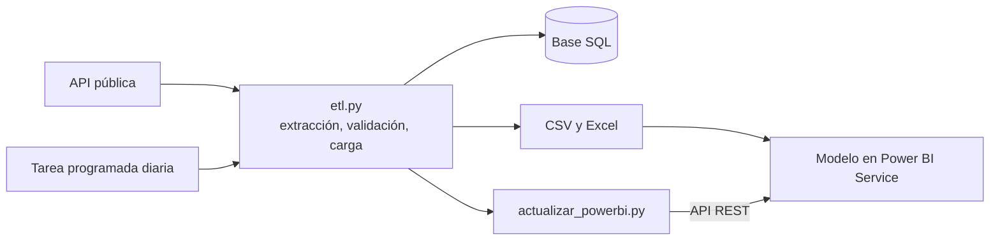

# ETL de indicadores económicos y actualización automática de Power BI

Proceso ETL en Python que descarga series históricas de indicadores económicos (UF, dólar, euro, UTM, IPC, TPM, cobre y desempleo) desde la API pública de [mindicador.cl](https://mindicador.cl), las carga en una base SQL y genera archivos listos para análisis.

## Qué hace

1. **Extracción**: consulta la API por indicador y año, con reintentos y espera creciente ante errores o límites de la API.
2. **Transformación** (Pandas): tipado de fechas y valores, descarte de filas inválidas y eliminación de duplicados.
3. **Carga** (SQLite): modelo con tabla de dimensión (`dim_indicador`) y de hechos (`fact_valor`). La carga es idempotente: se puede ejecutar todos los días y actualiza sin duplicar.
4. **Exportación**: reporte en Excel con el último valor y la variación en 12 meses de cada indicador, y archivos CSV que alimentan el [dashboard de Power BI](powerbi).

Cada ejecución queda registrada en la tabla `etl_ejecucion`.

5. **Actualización de Power BI**: [actualizar_powerbi.py](actualizar_powerbi.py) pide a la API REST de Power BI que actualice el modelo publicado y espera el resultado. Si la actualización falla, la tarea programada termina con error y queda a la vista, en vez de dejar un tablero desactualizado sin que nadie lo note.



## Cómo ejecutarlo

```bash
pip install -r ../requirements.txt
python etl.py                          # últimos 5 años
python etl.py --desde 2020 --hasta 2026
python etl.py --indicadores uf dolar

# Actualización diaria completa (por ejemplo, desde el Programador de tareas de Windows o cron)
python etl.py && python actualizar_powerbi.py
```

`actualizar_powerbi.py` usa una entidad de servicio de Entra ID con acceso al área de trabajo: variables `PBI_TENANT_ID`, `PBI_CLIENT_ID`, `PBI_CLIENT_SECRET`, `PBI_WORKSPACE_ID` y `PBI_DATASET_ID`.

## Consultas SQL

[consultas.sql](consultas.sql) incluye ejemplos sobre la base: último valor por indicador, variación mensual y en 12 meses, funciones de ventana para las mayores alzas diarias y un control de calidad que detecta meses sin datos.

La vista `vw_mensual` calcula promedio, mínimo, máximo y variaciones por mes. Para las tasas (IPC, TPM, desempleo) entrega la diferencia en puntos porcentuales en lugar de una variación relativa.

## Pruebas

`pytest 06-etl-indicadores-powerbi/tests` desde la raíz: transformación, carga idempotente, variaciones mensuales y en 12 meses, reintentos de la extracción y el ciclo de actualización de Power BI, sin depender de servicios externos.

## Limitaciones de la fuente

- La API no entrega datos de IPC para 2026 (consultado en noviembre de 2026). El proceso lo informa con una advertencia y el control de calidad lo lista.
- La UF se publica con semanas de anticipación, por lo que la base contiene fechas futuras. El reporte usa el valor vigente a la fecha de ejecución.

## Tecnologías

Python, Pandas, Requests, SQLite, SQL, openpyxl, API REST de Power BI, MSAL.
