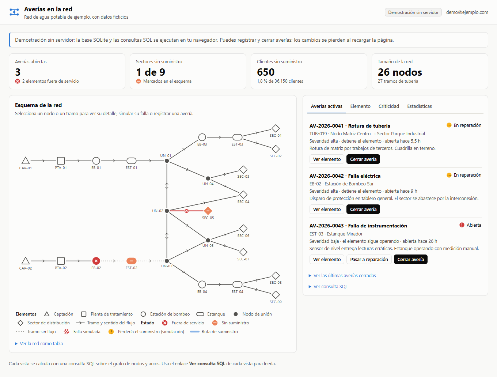
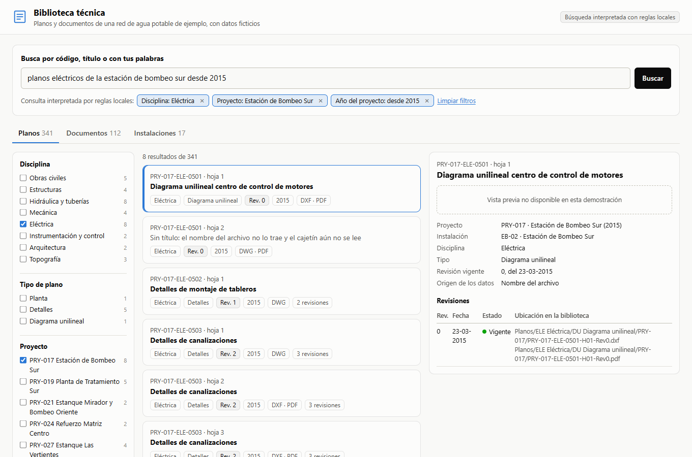
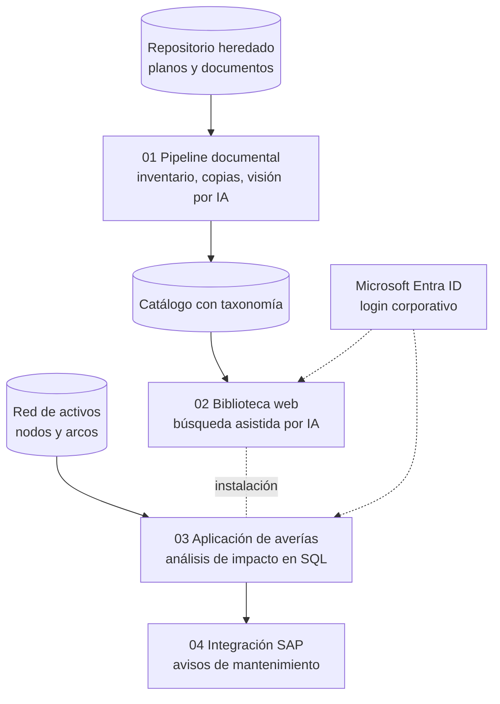

# Datos con propósito

Portafolio de datos, automatización e IA aplicada.


Matías Risso · Ingeniero Civil Industrial y Magíster en Ciencias de la Ingeniería Industrial.

Construyo procesos que ordenan, integran y aprovechan los datos de una organización: pipelines en Python, modelos en SQL, integraciones vía API con Microsoft 365 y sistemas empresariales, tableros en Power BI e inteligencia artificial aplicada a documentos y búsquedas.

Los proyectos de este repositorio son reconstrucciones de trabajo real, hechas con **datos ficticios** para poder mostrarlas. Cada uno se puede ejecutar y tiene pruebas automatizadas: **129 pruebas** en total, que pasan con Python 3.9 y 3.12.

[](https://github.com/mrissoc/datos-con-proposito/actions/workflows/pruebas.yml)

## Proyectos

| Proyecto | Qué resuelve | Tecnologías |
|---|---|---|
| [Pipeline documental con visión por IA](01-pipeline-documental-ia) | Inventaría, clasifica, deduplica y migra un repositorio heredado de planos, y lee sus cajetines con IA. Probado a escala con 303.000 archivos y 337 extensiones. | Python, SQL, Microsoft Graph, API de Anthropic |
| [Biblioteca técnica con búsqueda por IA](02-biblioteca-web) | Encuentra planos y documentos por taxonomía o escribiendo en lenguaje natural. | JavaScript, FastAPI, API de Anthropic |
| [Averías sobre una red modelada como grafo](03-averias-grafos-sql) | Registra averías y calcula en SQL quién queda sin servicio, qué elementos son críticos y por dónde llega el suministro. Login corporativo con Entra ID. | SQL recursivo, FastAPI, Entra ID |
| [Integración con SAP por OData](04-integracion-sap) | Crea avisos de mantenimiento en SAP a partir de las averías, sin duplicarlos aunque el proceso se interrumpa. | Python, OData, simulador de SAP Gateway |
| [Recordatorios masivos con Microsoft Graph](05-correos-masivos-graph) | Correos personalizados con copia a la jefatura según organigrama, Excel adjunto y KPIs diarios para Power BI. | Python, SQL, Microsoft Graph |
| [ETL de indicadores y Power BI](06-etl-indicadores-powerbi) | Carga diaria e idempotente de indicadores económicos y actualización automática del modelo de Power BI. | Python, Pandas, SQL, API de Power BI |
| [Web scraping a Excel](07-scraping-catalogo) | Recorre un catálogo completo con paginación y lo entrega en Excel con resumen. | Python, BeautifulSoup |

| | |
|---|---|
|  |  |

## Cómo se conectan

Los cuatro primeros proyectos forman un mismo sistema, como el que construí en mi trabajo actual:



## Experiencia en la que se basan

**Catalogación de planos de ingeniería con IA** (empresa de infraestructura, 2026, en curso)

- Pipeline en Python que clasifica, migra y cataloga cerca de 315.000 planos DXF y DWG alojados en SharePoint, con más de 300 extensiones de archivo distintas en el origen.
- Arquitectura ETL con base de staging: extracción de metadatos, deduplicación por huella, migración a una taxonomía documental definida junto al bibliotecólogo, enriquecimiento de esquema y reintentos ante los límites de la API de Microsoft Graph.
- Lectura del cajetín de cada plano con visión por IA (API de Anthropic): título, subtítulo, número de plano y otros identificadores.
- Aplicaciones web integradas con SharePoint para buscar planos, documentos y nodos, organizadas con taxonomía de estilo bibliotecario y con búsqueda asistida por IA.
- Aplicación de averías sobre un modelo de grafo (nodos y arcos) en SQL, con una integración vía API con SAP en evaluación.
- Despliegue en servidores de la organización con login corporativo, y migración de la ejecución a la nube junto al equipo de Cloud.

**Automatización de cumplimiento y reportabilidad** (empresa de servicios multinacional, 2026)

- Envío masivo de correos con Microsoft Graph: destinatarios dinámicos desde base de datos, copia a jefaturas según el organigrama, Excel adjunto por persona y correo en HTML. Implementado en un país, con expansión proyectada a otros dos.
- ETL para seguir la evolución de los KPIs de cursos en el tiempo y tableros en Power BI con actualización diaria automática.

**Otros**

- Automatización de procesos, integración de datos por API, Graph y FTP, y web scraping en el sector salud.
- Migración de datos de Google Cloud a Azure con scripts SQL de carga y validación.
- Modelos de optimización para ruteo de vehículos y localización de ambulancias (Python y Gurobi).

## Despliegue con login corporativo

Cómo se ponen en producción las aplicaciones web con Microsoft Entra ID, roles por grupo y credenciales protegidas en el servidor: [docs/despliegue.md](docs/despliegue.md).

## Cómo ejecutar

```bash
python -m venv .venv
.venv\Scripts\activate          # en Windows; en Linux o macOS: source .venv/bin/activate
pip install -r requirements.txt
pytest                          # las 129 pruebas
```

Cada carpeta explica cómo ejecutar su proyecto. Ninguno necesita credenciales para la demostración: los servicios externos (SharePoint, SAP, Graph, Power BI, la API de Anthropic) tienen simuladores o modos de prueba.
