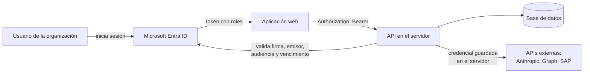

# Despliegue en servidores con login corporativo

Cómo se ponen en producción las aplicaciones web de este portafolio dentro de una organización que usa Microsoft 365, de modo que solo entren sus usuarios y cada uno con los permisos que le corresponden.



## 1. Registro de las aplicaciones en Entra ID

Se crean dos registros:

| Registro | Para qué | Configuración |
|---|---|---|
| API | Representa al servidor | "Exponer una API" con un alcance (`api://averias/Averias.Usar`) y roles de aplicación (`Averias.Operador`) |
| Aplicación web | Representa a la página | Plataforma "Aplicación de página única" con la URL del sitio como dirección de retorno; permiso delegado sobre el alcance de la API |

Los roles se asignan a grupos de la organización desde "Aplicaciones empresariales": quien está en el grupo de operadores puede registrar averías; el resto solo consulta.

## 2. Variables de entorno del servidor

| Variable | Valor |
|---|---|
| `AUTH_MODO` | `entra` |
| `ENTRA_TENANT_ID` | Id del tenant |
| `ENTRA_AUDIENCIA` | Id de aplicación de la API (`api://averias`) |
| `ENTRA_CLIENTE_WEB` | Id del registro de la aplicación web |
| `ENTRA_ALCANCE` | `api://averias/Averias.Usar` |

Las credenciales de servicios externos (`ANTHROPIC_API_KEY`, `GRAPH_CLIENT_SECRET`, la clave del usuario técnico de SAP) se guardan en el servidor, idealmente en un almacén de secretos como Azure Key Vault, y nunca llegan al navegador.

## 3. Ejecución

En un servidor Windows o Linux de la organización, o en Azure App Service:

```bash
pip install -r requirements.txt
uvicorn averias.api:crear_app --factory --host 0.0.0.0 --port 8000 --workers 2
```

Delante va el servidor web de la organización (IIS, Nginx o el propio App Service) con HTTPS. La aplicación no maneja certificados.

## 4. Base de datos

La demostración usa SQLite para que funcione sin instalar nada. En producción las mismas consultas corren en SQL Server o PostgreSQL; los cambios de sintaxis son acotados:

| SQLite | SQL Server |
|---|---|
| `WITH RECURSIVE` | `WITH` (la recursión es implícita) |
| `strftime('%Y-%m-%dT%H:%M:%SZ', 'now')` | `FORMAT(SYSUTCDATETIME(), 'yyyy-MM-ddTHH:mm:ssZ')` |
| `instr(texto, buscado)` | `CHARINDEX(buscado, texto)` |
| `||` para concatenar | `+` o `CONCAT()` |

## 5. Procesos desatendidos

El pipeline documental, la sincronización con SAP, los correos y el ETL corren como tareas programadas (Programador de tareas de Windows, cron o Azure Functions con temporizador). Se autentican como aplicación, sin usuario presente, con un registro de Entra ID que tiene solo los permisos que necesitan (`Sites.Selected` sobre la biblioteca de SharePoint, `Mail.Send` sobre un buzón, acceso al área de trabajo de Power BI).
